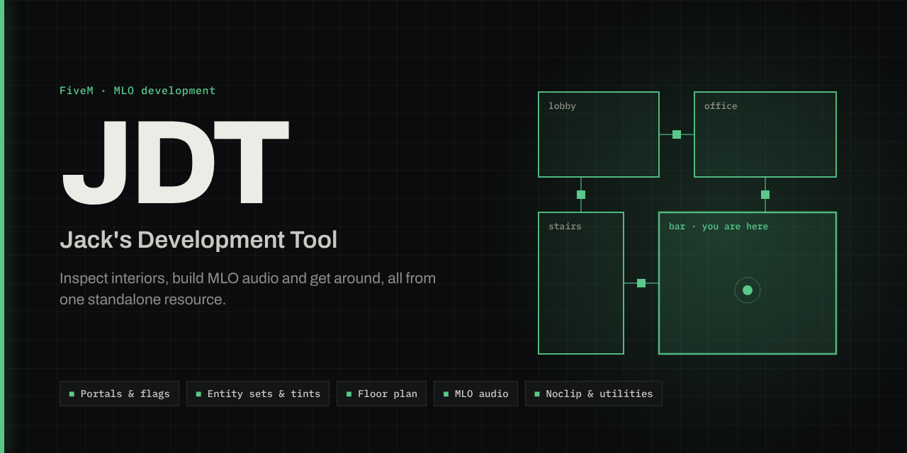
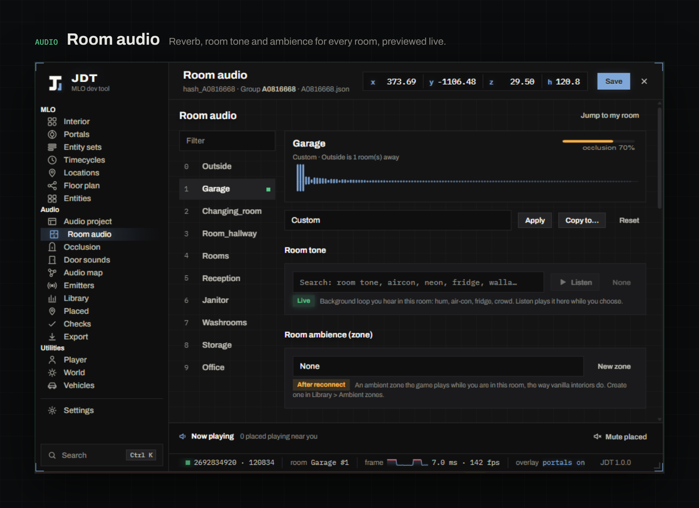
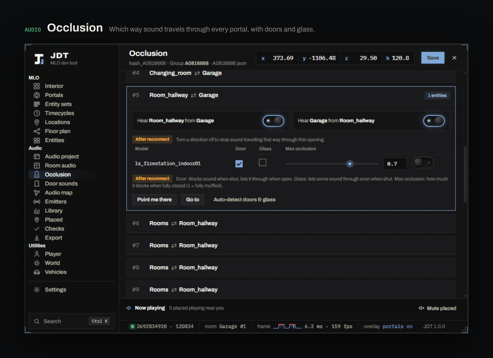

# JDT: Jack's Development Tool

**An all-in-one FiveM tool for building and testing MLOs.**

   

JDT runs as one standalone resource. It needs no other resources, no build step and no permission setup.

- **Inspect an interior while you stand in it:** rooms and their flags, portals, timecycles, entity sets and tints, every object, a floor plan, saved locations and teleports to GTA's own interiors.
- **Build its audio:** reverb, room tones, gunshot acoustics, occlusion, door sounds, ambient zones and your own sound files, plus placed sounds, radios and objects. JDT writes the native game files itself.
- **Get around while you work:** noclip, god mode, weather and time, a vehicle spawner, and teleports to coordinates or the map marker.

## Install

1. Download the release and put the `jdt` folder in your server's `resources/` folder.
2. Add `ensure jdt` to `server.cfg`.
3. Start the server, join, and press **F5**.

> JDT has no permission checks: everyone on the server can open it. Use it on a development server.

**Updating:** replace the folder, keeping your `saved_interiors/`, `sounds/` and `data/` folders. Then run `refresh` and `ensure jdt`, or restart the server.

## Keys

| Key | Does |
| --- | --- |
| F5 | Open / close the panel (`Esc` also closes it) |
| F11 | Noclip (free camera) |
| F10 | Teleport to the map marker |
| Hold right mouse | Walk and look around with the panel open |
| Ctrl K | Search tabs, rooms, portals, locations and commands |
| Alt 1…0 | Switch tabs |
| Ctrl S | Save the interior project |

Players can change these keys live in **Settings → Keybinds**: click a key, then press the new one. The change works straight away and is saved on that player's PC. God mode and repairing your vehicle can get a key there too.

## What's inside

### MLO

| Tab | |
| --- | --- |
| Interior | Interior stats and one row per room: flags, timecycle and the room you are in. **Edit** changes every room flag, the timecycle and the extents, with a reset per room and *Undo all changes*. |
| Portals | Portals drawn in the world as glowing outlines with labels, coloured by type, fading with distance. Per portal: From / To rooms, flags, **Highlight** and **Go to**. |
| Entity sets | **Found automatically.** For custom MLOs, the server reads the MLO's `.ytyp` and lists every set. For GTA's own interiors, JDT lists the sets known for that interior. Turn sets on and off one by one or all at once, delete them from the list and tint each set. The **Interior tint** bar tints an entity set, the objects in your room or every object in the interior, and can undo object tints. |
| Timecycles | The current room's timecycle, reset, any name or hash, and 1,292 GTA timecycles to click and apply. |
| Locations | Live coordinates (copy as `x, y, z`, `vector3` or `vector4`). Save, rename, filter, teleport, export and import positions. **GTA interiors:** 141 of the game's interiors in groups. Teleport loads what each one needs (IPLs) and takes you inside. |
| Floor plan | Every room placed where its doorways are, one frame per floor, from 1 room to hundreds. Links between rooms (yellow when one-way), exits to outside, stairs and broken portals. Zoom, pan, pin rooms, click a link to edit it. |
| Entities | Every object of the interior or around you, with filters and search. The object nearest to you or the one you aim at is outlined in the world. The inspector covers visibility, collision, opacity, teleport and copying the name, hash, `vector4` or a YMAP item. |
| Export XML | Rooms, portals and entity sets as XML for your `.ytyp` (top bar). |

### Audio

| Tab | |
| --- | --- |
| Audio project | Group, archetype name, what will be generated, and reading an MLO's existing audio back in. |
| Room audio | Reverb with an echo preview, presets, room tone with **Listen**, room ambience zone and gunshot acoustics. |
| Occlusion | Which way sound travels through each portal, doors and glass, and auto-detect. |
| Door sounds | A sound for each door model, **Test** (opens the real door), and custom doors. |
| Audio map | Rooms and portals as a sound graph. |
| Emitters | Every audio emitter around you, nearest first. **Locate nearest** draws a path to it. You can show them in the world, play / pause / solo your own, and switch or take over the game's own. |
| Library | GTA sounds, your own sound files, ambient zones, emitters, radios, objects and mute zones. ▶ previews a sound, **Place it** lets you aim and place it in the world. |
| Placed | Everything you placed, edited live in the world. |
| Checks | Problems to fix before exporting, with buttons that take you to them. |
| Export | Writes the native files, either into JDT, into the MLO's resource or into a stand-alone folder. |

The audio workflow is described in [docs/usage-guide.md](docs/usage-guide.md).

### Utilities

| Tab | |
| --- | --- |
| Player | **Noclip:** a free camera. The mouse aims, W flies where you look, Shift boosts and the wheel sets the speed (up to 200). **God mode.** |
| World | Teleport to coordinates (paste `x, y, z`, `vector3(...)` or `vector4(...)`) or to the map marker. Weather, time, freeze time, and back to the server's weather and time. Only you see the changes. |
| Vehicles | Your vehicle's state, **Repair and clean**, **Max performance**. A spawner with 910 vehicles plus any add-on model: engine, brakes, transmission, suspension and turbo maxed, optional armour and bulletproof tyres. |

### Settings

Themes, accent colour, animations, smooth scrolling, density, window size, opacity and text size. Keybinds. **Factory reset** puts every setting back to its default.

## Configuration

Server owners set everything in `config.lua`. The defaults work as they are. See [docs/configuration.md](docs/configuration.md) for every section, the convars and the exports.

## Performance

- Lua only does what has to touch the game: natives, teleports and drawing in the world. Lists, filters, maths and saved data live in the panel.
- While the panel is closed nothing runs, except features you switched on (portal outlines, a selected object, placed sounds, noclip).
- The panel checks your room and position only while it is open (`Config.Inspect.pollMs`, 500 ms by default). It fetches the full interior again only when something changed.
- Portal outlines draw only the nearest portals, so a large MLO costs the same as a small one.

## Languages

English, Danish, German, Finnish, French and Turkish. The `setr jdt:locale de` convar picks the language. Missing strings fall back to English.

## Credits and license

Made by **Jack**, author and creator of JDT.

Thanks to:

- [Hedgehog Technologies](https://github.com/Hedgehog-Technologies) for [ht_mlotool](https://github.com/Hedgehog-Technologies/ht_mlotool) (LGPL-3.0)
- [Molo Modding](https://github.com/molossen) for [molo_soundemitters](https://github.com/molossen/molo_soundemitters)
- Michael Xanders for MLOX Tool
- [dexyfex](https://github.com/dexyfex) for [CodeWalker](https://github.com/dexyfex/CodeWalker)

More in [docs/acknowledgements.md](docs/acknowledgements.md).

License: LGPL-3.0-or-later (see `LICENSE`). The fonts are Archivo and IBM Plex Mono, under the SIL Open Font License (`web/fonts/`).
